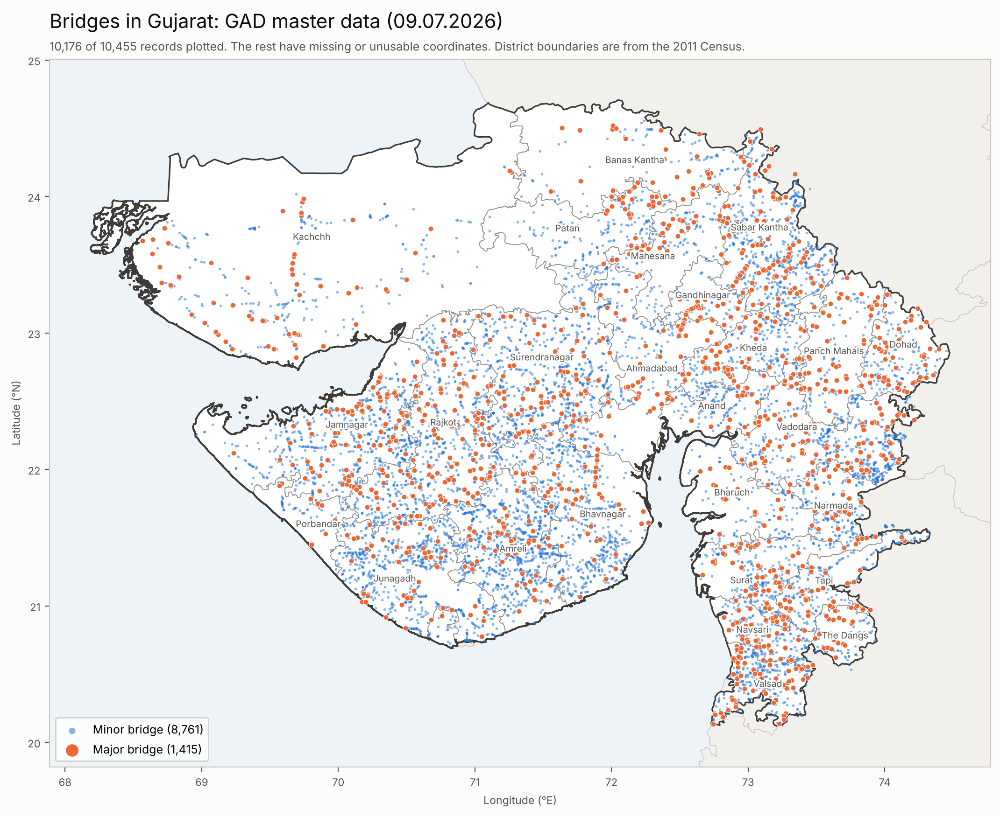

# Gujrat-Bridge-Inventory

Bridge inventory for Gujarat (Master Data for GAD Module, 09.07.2026), mapped onto district shapefiles.



## Contents
- `Master Data for GAD Module_09.07.2026.xlsx`: source inventory (sheets *Major Bridge*, *Minor Bridge*)
- `shapefiles-master/`: India and state boundary files (Hindustan Times Labs)
- `scripts/`: the Python code used for every result in this repo
- `output/`: generated map, cleaned coordinates, data-completeness table, bridge typologies (`bridge_typology.md`, `bridge_typology.xlsx`)
- `PROGRESS.md`: log of what was done and why

## Reproduce
```bash
pip install -r requirements.txt
python3 scripts/plot_bridge_map.py
python3 scripts/assess_opensees_readiness.py
python3 scripts/classify_bridge_typology.py
```
